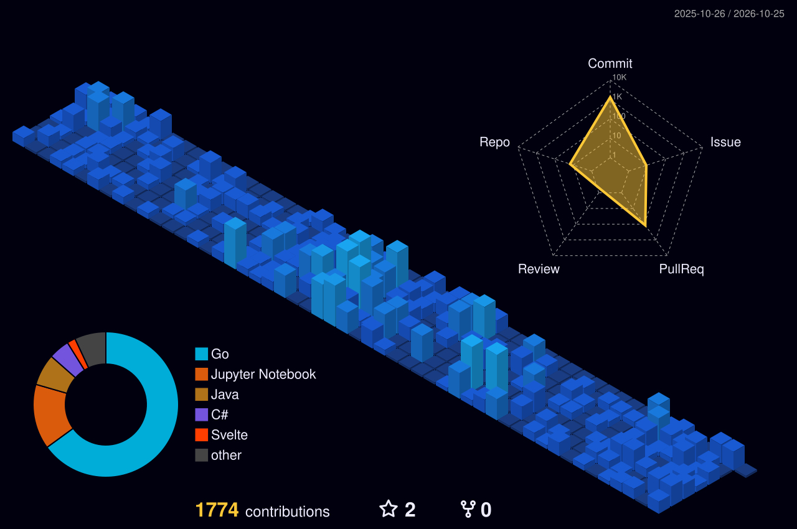

# Hi there / Olá 👋

  

---

### 🇺🇸 About Me

I am a **Software Engineering student** and an aspiring **Backend Developer**. My core focus lies in **Go** and **Python** , and I am planning to try **Rust** out soon.
---

### 🇧🇷 Sobre Mim

Sou graduando em **Engenharia de Software** e desenvolvedor **Backend** em formação. Tenho foco principal em **Go** e **Python**, e estou planejando experimentar **Rust** em breve.
---

### 🛠️ Tech Stack

#### 💻 Languages (Linguagens)

#### 🗄️ Infrastructure & Databases (Infraestrutura e Base de Dados)

#### 🔧 Setup & OS

---

### 🤝 Contact / Contato

  

# Ad Maiorem Dei Gloriam
